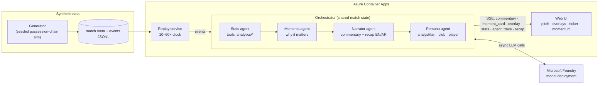

# Echo Pitch: the multi-agent match storyteller

> **Every match, explained, for every fan.** Echo Pitch turns a live stream of synthetic football events into
> explainable match intelligence: live commentary, "why it matters" moment cards, timed broadcast overlays and
> a full-time recap. It is personalised for an analyst or a casual fan, in English or Arabic, around your club
> and your player.

Built for the **Microsoft × Premier League "Inside the Game" Developer Hackathon**. It uses Microsoft Foundry
and Microsoft Agent Framework, and is ready to deploy to Azure Container Apps.
All clubs, players and data are **fictional and synthetic**.


## The problem

Broadcast graphics and data feeds tell viewers *what* happened (a shot, 0.41 xG, 52% possession), but rarely
*why it matters*. And every viewer gets the same output. A data-hungry analyst and a first-time fan in Amman or
Lagos want very different stories from the same 2,000 events. Writing those stories by hand, live, in several
languages, does not scale.

## What Echo Pitch does: the five pipeline stages (Rules §4.1)

| Stage | What the rules ask for | How Echo Pitch does it | Code |
|---|---|---|---|
| **1. Ingest** | synthetic events as they happen | A seedable generator produces about 1,900 football-realistic events per match (passes, carries, shots, tackles, pressure, possession changes, fouls, goals, saves). A replay service streams them over SSE at 10–60×. | `generator/`, `app/main.py` |
| **2. Interpret** | stats, patterns, context | Deterministic analytics: possession, pass difficulty (0–100), xG timeline, pressing index, rolling momentum, key-moment candidates | `analytics/stats.py` |
| **3. Explain** | *why* a moment matters | The **Moments agent** explains each moment through game state (lead, equaliser, cushion), timing, with or against the run of play, xG probability, *control vs chaos* and pressure shifts | `agents/` |
| **4. Render** | on-screen, alongside the match | Timed, machine-readable **overlay cards** (`start_s`, `duration_s`, `anchor`, `payload`): goal banner, shot xG, pass difficulty, speed alert, player tag, stat bar, moment lower-third. A broadcast-style web UI renders them. | `agents/orchestrator.py`, `web/` |
| **5. Personalise** | analyst vs fan, club, player, language | The **Persona agent** has Analyst and Fan modes, a favourite-club perspective, a favourite-player focus (★ tags on every touch) and EN/AR output with full RTL | `agents/specialists.py`, `web/app.js` |

It also covers the suggested features: player identification (name tags plus speed alerts above thresholds),
pass quality (distance, accuracy, difficulty), ball and shot speed, narratives and recaps, explainability, data
innovation, and multi-language storytelling.

## Architecture



More detail is in [docs/architecture.md](docs/architecture.md).

### Agents (Microsoft Agent Framework)

| Agent | Role | Inputs and tools |
|---|---|---|
| **Stats** | Owns every number and never invents one. Gives periodic insights. | Agent Framework function tools: `get_live_stats`, `get_key_moments`, `get_explainability` (wrapping `analytics/`) |
| **Moments** | Explains why a moment matters | Moment JSON plus context: margin, momentum before the action, xG, pressing phase |
| **Narrator** | Live commentary lines and the full-time recap, EN and AR | Event facts, style, language |
| **Persona** | Shapes output for the viewer and decides which overlays to show | Persona, favourite club and player, language |

Each agent is an `agent_framework.Agent` on a shared `agent_framework.foundry.FoundryChatClient`, authenticated
with `DefaultAzureCredential` (a managed identity on Azure, so there are no keys).

### Shared state, handoffs and failure recovery

- **Shared state (blackboard):** the orchestrator holds the event log, score, fouls, moment log and agent trace.
  Every agent reads from it, and the Stats tools query it live.
- **Handoffs:** for each key moment the work passes Stats (context) → Moments (why) → Persona (audience) →
  render (card and overlay). Narrator → Persona handles commentary lines.
- **Never blocks the broadcast:** every line and card is rendered immediately from deterministic EN/AR templates.
  When Foundry is configured, LLM calls run **concurrently in the background** and stream
  `commentary_update` and upgraded `moment_card` events as they finish, so slow model calls never make the
  replay lag.
- **Recovery:** each agent call has a timeout and *N* retries. If they all fail, a minimal **safe template**
  is used. Every step is emitted as an `agent_trace` (`ok` / `recovered` / `fallback`, attempts, latency) and
  shown in the UI's agent strip.
- **Fault injection for demos:** `ECHO_FAULT_AGENTS=narrator` makes the first call fail so you can watch the
  retry; `narrator!` makes every call fail so you can watch the fallback.

## Microsoft technology used

| Technology | How |
|---|---|
| **Microsoft Foundry** | Model deployment (e.g. `gpt-4o-mini`) behind all four agents, via the Foundry project endpoint |
| **Microsoft Agent Framework** | `Agent`, `FoundryChatClient`, Python function tools; multi-agent orchestration with handoffs |
| **Azure Container Apps** | Hosting (`Dockerfile`, `infra/deploy_aca.sh`), managed identity for keyless Foundry access, external ingress for SSE |
| **Azure Container Registry** | Cloud image build (`az acr build`) |
| **GitHub Copilot** *(planned)* | Planned for upcoming development work; this row will be updated once it is used |
| **GitHub Actions** | CI: tests, determinism check, Docker build and smoke test (`.github/workflows/ci.yml`) |

## Synthetic data

- **The generator** is a possession-chain simulator in `generator/core.py`.
  - Pass success depends on distance, pressure and the final third; overall completion is about 78%.
  - Shots run about 9–17 per team. xG comes from a logistic model on distance and goal angle, and goals are sampled from xG.
  - Momentum follows a random walk, and there is a soft cap on shot imbalance.
  - Each match has two scripted dramatic moments (a wonder save and a late big chance) that start from the real ball position.
- **Pitch:** coordinates are in metres on 105×68. Home attacks toward x=105 in both halves.
- **Schema:**
  - Events: `match_id, event_id, period, minute, second, team, team_name, player_id, player_name, type, x, y, end_x, end_y, outcome, speed_kmh, pressure_level, xg`.
  - Metadata: teams, 4-3-3 lineups, venue, kickoff and final score.
- **Demo matches:** `python -m generator --demo --out data/` gives three typical matches (seeds 53, 58, 63; 1-1, 3-1, 1-2).
  The output is deterministic, and CI checks this.
- **No real data:** there is no real Premier League data, footage, club or player name anywhere (Rules §4.7).

## Run it

```bash
python -m venv .venv && . .venv/bin/activate        # Windows: .venv\Scripts\activate
pip install -r requirements.txt
python -m generator --demo --out data/               # optional: data/ is already included
LLM_MODE=offline uvicorn app.main:app --port 8000    # Windows PowerShell: $env:LLM_MODE="offline"; uvicorn app.main:app
# open http://localhost:8000  and press Kick off
# deep link: /?match=EP-2026-002&speed=60&start=82&club=home&lang=ar&persona=analyst&autoplay=1
```

**With Microsoft Foundry** (copy `.env.example`):

```bash
az login
export LLM_MODE=foundry
export FOUNDRY_PROJECT_ENDPOINT=https://<account>.services.ai.azure.com/api/projects/<project>
export FOUNDRY_MODEL=gpt-4o-mini
uvicorn app.main:app --port 8000
```

**Docker and Azure Container Apps:**

```bash
docker build -t echo-pitch . && docker run -p 8000:8000 echo-pitch
AZ_ACR=<unique-name> ./infra/deploy_aca.sh     # see the header of the script for all variables
```

### Measured on Microsoft Foundry (gpt-5-mini, Global Standard)

A full replay of EP-2026-002 at 60× was run in English (fan) and Arabic (analyst) at the same time. The script
is `scripts/foundry_eval.py` and the raw results are in `docs/foundry_eval.json`.

| | EN | AR |
|---|---|---|
| LLM calls per match | 35 | 35 |
| LLM latency, p50 / p95 | 2.8 s / 3.9 s | 2.7 s / 4.3 s |
| Replay lag (event arrival vs schedule) | ≤ 1.0 s max | ≤ 1.0 s max |
| Tokens in / out | 17.1k / 2.7k | 17.0k / 3.3k |
| Cost per match per viewer stream | about $0.010 | about $0.011 |
| Agent failures | 0 | 0 |

The cost uses gpt-5-mini list prices of $0.25 per 1M input and $2.00 per 1M output tokens.

Cost controls:
- Only key moments, periodic insights and the recap go to the model.
- `reasoning.effort=minimal`.
- Output tokens are capped: 200 for a line, 400 for a moment or insight, 500 for the recap.
- No temperature parameter is sent.
- Persona context is folded into each prompt instead of an extra call.
- A language guard retries any reply in the wrong language.

Live test: `ECHO_FOUNDRY_IT=1 python -m pytest tests/test_foundry_integration.py`.


### API

| Method | Path | Purpose |
|---|---|---|
| GET | `/api/matches`, `/api/matches/{id}/meta`, `/api/matches/{id}/events?upto=N` | data |
| GET | `/api/matches/{id}/stats?upto=N` | full analytics snapshot |
| POST | `/api/replays` `{match_id, speed 10–60, start_minute}` | start a replay |
| GET | `/api/replays/{rid}/stream?persona=&lang=&club=&player=&from_now=` | SSE agent stream |
| GET | `/api/replays/{rid}/state` · DELETE `/api/replays/{rid}` | live state, stop |
| GET | `/api/config`, `/api/health` | mode, liveness |

## Testing

```bash
LLM_MODE=offline python -m pytest -q
```

There are 45 tests, and they run fully offline:
- **generator:** schema, time ordering, goals match the scoreline, realism ranges, determinism, ball continuity, unique names, the shot cap;
- **analytics:** bounds, monotonic xG, stoppage-time windows, momentum smoothing;
- **agents:** English and Arabic, persona differences, the overlay schema, retry and recovery, forced fallback, the Foundry code path with stand-in agents, LLM calls not blocking the replay, building the Foundry agents;
- **API and SSE:** endpoints, validation, the Arabic stream, the UI being served.

`python scripts/screenshot.py` captures `docs/ui.png` with headless Chrome (needs Playwright).

## Repository layout

```
generator/   synthetic match generator (CLI: python -m generator)
analytics/   deterministic stats + explainability (agent tools)
agents/      config, Foundry/Agent Framework wiring, specialists, EN/AR templates, orchestrator
app/         FastAPI: data API, replay service, SSE stream, static UI
web/         single-page broadcast UI (vanilla JS)
infra/       Azure Container Apps deploy script
docs/        architecture, demo video script, pitch, screenshots
tests/       pytest suite
```
