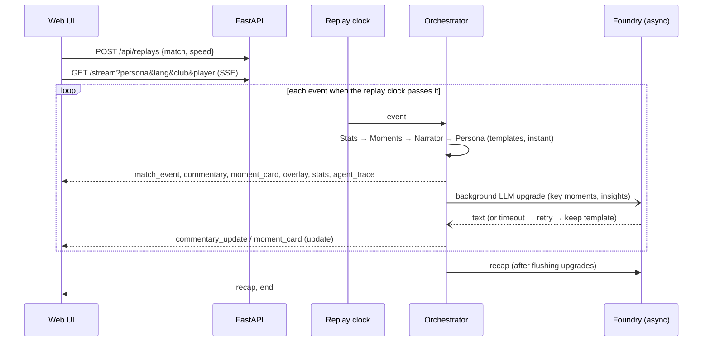

# Echo Pitch architecture

## Components

| Component | Tech | Responsibility |
|---|---|---|
| Generator | Python | Seeded possession-chain simulation producing synthetic matches (`meta.json` + `events.jsonl`) |
| Analytics | Python (pure functions) | Possession, pass difficulty, xG timeline, pressing index, momentum, key moments, control vs chaos, pressure shifts, rhythm |
| Replay service | FastAPI | Replays an event log on a 10–60× match clock; supports joining mid-match |
| Orchestrator | Python asyncio | Shared match state, handoffs, retries and fallbacks, background LLM upgrades, overlay timing |
| Agents | Microsoft Agent Framework + Foundry | Stats, Moments, Narrator, Persona |
| UI | HTML/CSS/vanilla JS | Pitch map, overlays, scoreboard, ticker, moment cards, momentum chart, controls, recap |
| Hosting | Azure Container Apps + ACR | Container, managed identity, external HTTPS ingress |

## Request flow



## Shared state (blackboard)

`MatchOrchestrator` holds:
- `events`: the log so far;
- `score` and `fouls`;
- `moment_log`: the cards emitted;
- `trace`: agent calls with status, attempts and latency;
- viewer `ctx`: language, persona, club, player.

The Stats agent's Agent Framework tools (`get_live_stats`, `get_key_moments`, `get_explainability`) read this
state live, so the model is grounded in deterministic numbers.

## Handoffs

1. **Stats** finds the trigger (goal, big chance at xG ≥ 0.30, key save, pressing spike above mean + 1.5σ) and builds the context:
   margin, momentum just before the action, pressing value, control-vs-chaos label, turnovers.
2. **Moments** turns the context into "why it matters".
3. **Persona** adapts it to the viewer: analyst or fan, favourite-club perspective, ★ for the favourite player.
4. **Render** emits the `moment_card` plus a timed `overlay` (lower third). Persona also filters which overlay kinds each audience sees.
5. **Narrator** writes live lines for every notable event (routine lines are throttled to one per 40 match seconds)
   and the recap, including a deterministic player of the match.

## Failure recovery

```
attempt 1 ── ok ───────────────► status "ok"
    │ fail/timeout
attempt 2 ── ok ───────────────► status "recovered"
    │ fail
safe template ─────────────────► status "fallback"
```

- Timeout per call: `LLM_TIMEOUT_S` (default 8 s). Retries: `LLM_RETRIES` (default 1).
- The UI always has a deterministic line or card first. LLM text only *upgrades* it, so outages degrade
  quality, never availability.
- `ECHO_FAULT_AGENTS` injects failures for demos and tests.

## Overlay contract (for a rendering partner)

```json
{"overlay_id": "ov-00042", "kind": "shot_xg", "anchor": "top_right", "start_s": 5128,
 "duration_s": 5, "clock": "86'", "lang": "en",
 "payload": {"player": "Pavel Garrow", "xg": 0.44, "speed_kmh": 71.2, "outcome": "goal", "team": "home"}}
```

| Field | Values |
|---|---|
| `kind` | `goal_banner`, `shot_xg`, `pass_difficulty`, `speed_alert`, `player_tag`, `stat_bar`, `moment_card` |
| `anchor` | `top`, `top_right`, `lower_third`, `pitch` |

## Time model

- The displayed clock keeps first-half stoppage time as `45+n'`.
- Analytics windows are keyed by `(period, window)`, so first-half stoppage gets its own `45+'` window and never
  mixes with minutes 45–50 of the second half.
- Momentum uses a monotonic timeline index `t` with exponential decay (τ = 3 min), a sparsity prior and light
  smoothing, so thin stoppage-time minutes cannot whip the curve to extremes.

## Deployment

- `Dockerfile`: python:3.12-slim, non-root user, healthcheck, uvicorn on port 8000.
- `infra/deploy_aca.sh`, using the az CLI:
  - creates the resource group, ACR (cloud build, or a local docker/podman build with `LOCAL_BUILD` where ACR Tasks are blocked) and the Container Apps environment;
  - creates the app with a system-assigned identity, 0–1 replicas (scale to zero; one replica keeps in-memory replays and the spend guard consistent), 0.5 vCPU / 1 GiB and external ingress;
  - grants the *Cognitive Services User* role on the Foundry account (keyless auth via managed identity).
- Live: UAE North, same region as the Foundry resource. Known limit: on an *express* Container Apps environment the platform rejects later `az containerapp update` calls while the app has a system-assigned identity, so a new image currently means recreating the app (or moving to a standard environment).
- `.github/workflows/ci.yml`: pytest offline, a check that the data is deterministic, a Docker build and a smoke test.

## Limitations and next steps

- Replay sessions live in memory, so the app runs as a single replica. Azure Cache for Redis would allow scale-out.
- Templates use Latin-script names inside Arabic text. Transliteration is a planned addition.
- Auto-eventing from video is out of scope; the event feed is synthetic.
