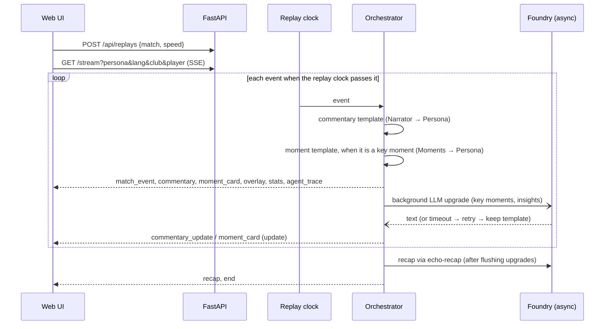

# Echo Pitch architecture

## Components

| Component | Tech | Responsibility |
|---|---|---|
| Generator | Python | Seeded possession-chain simulation producing synthetic matches (`meta.json` + `events.jsonl`) |
| Analytics | Python (pure functions) | Possession, pass difficulty, xG timeline, pressing index, momentum, key moments, control vs chaos, pressure shifts, rhythm |
| Replay service | FastAPI | Replays an event log on a 10–60× match clock; supports joining mid-match |
| Orchestrator | Python asyncio | Shared match state, handoffs, retries and fallbacks, background LLM upgrades, overlay timing |
| Agents | Microsoft Agent Framework + Foundry | Four roles: Stats, Moments, Narrator, Persona. Foundry also builds `echo-recap` for the Narrator's full-time recap |
| UI | HTML/CSS/vanilla JS | Pitch map, overlays, scoreboard, ticker, moment cards, momentum chart, controls, recap |
| Hosting | Azure Container Apps + ACR | Container, managed identity, external HTTPS ingress |

## Request flow



## Shared state (blackboard)

`MatchOrchestrator` holds:
- `events`: the log so far;
- `score` and `fouls`;
- `moment_log`: the cards emitted;
- `trace`: agent calls with status, attempts and latency;
- viewer `ctx`: language, persona, club, player.

The Stats agent's Agent Framework tools (`get_live_stats`, `get_key_moments`, `get_explainability`) read this
state live, so the model is grounded in deterministic numbers.

## Handoffs

The orchestrator chooses the path. The Stats agent is not a step inside the moment or commentary call.

1. **Trigger.** The orchestrator detects a goal; a big chance (a shot that is not a goal and not saved, xG ≥ 0.30); a key save (a wonder save, or the shot xG ≥ 0.15); or a pressing spike (the closed window is at least 40 and at or above the mean + 1.5σ). It attaches analytics context: margin, momentum just before the action, pressing value, control-vs-chaos label, turnovers.
2. **Moments** turns that context into "why it matters".
3. **Persona** adapts it: analyst or fan, favourite-club perspective, ★ for the favourite player. An analyst's overlays add shot xG and pass difficulty. A fan's overlays add the speed alert. Both audiences may see the goal banner, moment card, stat bar and player tag (the player tag is emitted on the favourite player's touches).
4. **Render** emits the `moment_card` plus a timed lower-third `overlay`.
5. **Narrator** writes the commentary line, then Persona shapes it. Routine lines are throttled to one per 40 match seconds, unless the event is the viewer's favourite player. At full time the Narrator writes the recap, including a deterministic player of the match, through the separate `echo-recap` agent when Foundry is on.
6. **Stats** writes one insight every 10 match minutes. Its tools (`get_live_stats`, `get_key_moments`, `get_explainability`) read the same blackboard.

## Failure recovery

```
attempt 1 ── ok ───────────────► status "ok"
    │ fail/timeout
attempt 2 ── ok ───────────────► status "recovered"
    │ fail
safe template ─────────────────► status "fallback"
```

- Timeout and retries are `LLM_TIMEOUT_S` and `LLM_RETRIES`. See Configuration below.
- The UI always has a deterministic line or card first. LLM text only *upgrades* it, so outages degrade
  quality, never availability.
- `ECHO_FAULT_AGENTS` injects failures for demos and tests. `narrator` fails that agent's first call;
  `narrator!` fails every call.

## Configuration

`Settings.from_env()` (`agents/config.py`) loads a repo-root `.env` unless `ECHO_NO_DOTENV` is set. Variables already in the environment win.

| Variable | Default |
|---|---|
| `LLM_MODE` | `foundry` when `FOUNDRY_PROJECT_ENDPOINT` is set, otherwise `offline`. `foundry` with no endpoint falls back to offline and records a warning trace. Endpoint alias: `AZURE_AI_PROJECT_ENDPOINT`. |
| `FOUNDRY_MODEL` | `gpt-5-mini`. Alias: `AZURE_AI_MODEL_DEPLOYMENT_NAME`. |
| `LLM_TIMEOUT_S` | 20 seconds in `from_env()`. A `Settings()` built in code uses 8 seconds. `infra/deploy_aca.sh` sets 8 on the container. |
| `LLM_RETRIES` | 1 |
| `LLM_MAX_COMPLETION_TOKENS` | 400. A Narrator line uses at most 200. The recap agent uses at least 500. |
| `LLM_REASONING_EFFORT` | `minimal`. Unset or empty keeps `minimal`. |
| `LLM_PERSONA_REWRITE` | off (`0`). `1`, `true` or `yes` adds an extra Persona LLM pass. |
| `FOUNDRY_CREDENTIAL` | `auto` (the default): Azure CLI when `az` is on PATH and `CONTAINER_APP_NAME` is unset; managed identity (`AZURE_CLIENT_ID`) when `CONTAINER_APP_NAME` is set; otherwise `DefaultAzureCredential`. `cli` and `managed` force those credentials. Any other value uses `DefaultAzureCredential`. |
| `ECHO_FAULT_AGENTS` | empty |
| `BUDGET_STREAMS_PER_IP_HOUR` | 6 |
| `BUDGET_STREAMS_PER_DAY` | 150 |
| `BUDGET_MAX_CONCURRENT` | 4 |
| `BUDGET_MAX_REPLAYS` | 200 |
| `ECHO_DATA_DIR` | the repo `data/` directory |

`ECHO_FOUNDRY_IT=1` runs the two live Foundry tests. The test suite sets `ECHO_NO_DOTENV` so a developer `.env` is not loaded.

## Overlay contract (for a rendering partner)

```json
{"overlay_id": "ov-00042", "kind": "shot_xg", "anchor": "top_right", "start_s": 5128,
 "duration_s": 5, "clock": "86'", "lang": "en",
 "payload": {"player": "Pavel Garrow", "xg": 0.44, "speed_kmh": 71.2, "outcome": "goal", "team": "home"}}
```

| Field | Values |
|---|---|
| `kind` | `goal_banner`, `shot_xg`, `pass_difficulty`, `speed_alert`, `player_tag`, `stat_bar`, `moment_card` |
| `anchor` | `top`, `top_right`, `lower_third`, `pitch` |

## Time model

- The displayed clock keeps first-half stoppage time as `45+n'`.
- Analytics windows are keyed by `(period, window)`, so first-half stoppage gets its own `45+'` window and never
  mixes with minutes 45–50 of the second half.
- Momentum uses a monotonic timeline index `t` with exponential decay (τ = 3 min), a sparsity prior and light
  smoothing, so thin stoppage-time minutes cannot whip the curve to extremes.

## Deployment

- `Dockerfile`: python:3.12-slim, non-root user, healthcheck, uvicorn on port 8000.
- `infra/deploy_aca.sh`, using the az CLI:
  - creates the resource group, ACR (cloud build, or a local docker/podman build with `LOCAL_BUILD` where ACR Tasks are blocked) and the Container Apps environment;
  - creates (or updates) the app with a user-assigned identity for image pull and Foundry, 0–1 replicas (scale to zero; one replica keeps in-memory replays and the spend guard consistent), 0.5 vCPU / 1 GiB and external ingress;
  - grants the *Cognitive Services User* role on the Foundry account (keyless auth via managed identity).
- Live: UAE North, same region as the Foundry resource. The subscription provisions *express* environments, which reject updates to apps with a system-assigned identity, so the app uses a user-assigned identity; re-running the script ships a new image with `az containerapp update`.
- `.github/workflows/ci.yml`: pytest offline, a check that the data is deterministic, a Docker build and a smoke test.

## Limitations and next steps

- Replay sessions live in memory, so the app runs as a single replica. Azure Cache for Redis would allow scale-out.
- Templates use Latin-script names inside Arabic text. Transliteration is a planned addition.
- Auto-eventing from video is out of scope; the event feed is synthetic.


## v2 additions (27 Oct 2026)

- **Verifier (Guard) agent** (`agents/verifier.py`), with no LLM. The orchestrator calls `_verify` on every template line, card, insight and recap, and calls `_guarded` on every LLM draft. A rejected draft is rewritten once by the same writer, with the problems as feedback. If the rewrite fails too, the verified template line stays. Verdicts are emitted as `agent_trace` (agent `verifier`). Evidence is attached to `commentary`, `commentary_update`, `moment_card` and `recap`, and every verdict is appended to the replay's audit list.
- **Producer approval**: `stream?approval=true` sends LLM updates with `pending: true`. The UI holds them until a producer approves. Decisions go to `POST /api/replays/{id}/decisions`, and the log is at `GET /api/replays/{id}/audit`.
- **Speech**: `POST /api/tts` (`app/tts.py`, Azure AI Speech REST, neural voices per language, LRU cache). The UI queue prefetches audio and falls back to `speechSynthesis`.
- **MCP**: `echo_mcp/server.py` (MCP Python SDK 2.x `MCPServer`), over stdio (`python -m echo_mcp`) and stateless streamable HTTP mounted at `/mcp/`.
